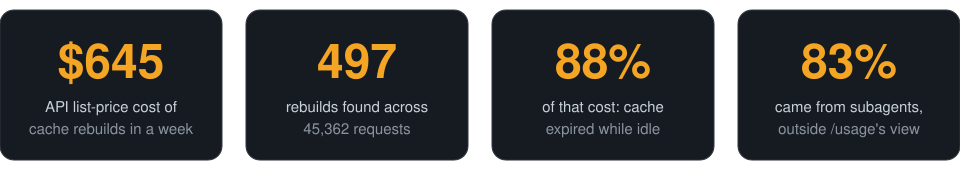
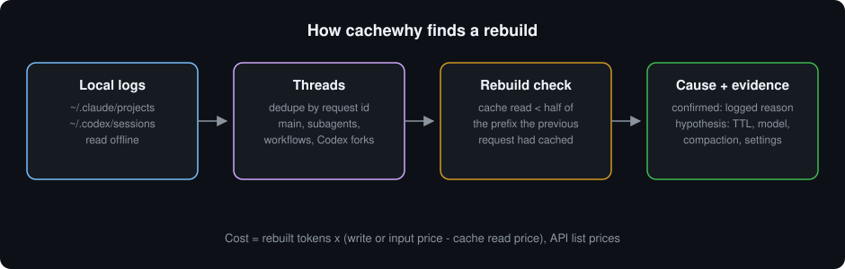

<div align="center">

<picture>
  <source media="(prefers-color-scheme: dark)" srcset="assets/banner-dark.svg">
  
</picture>

<p>
  
  
  
</p>

<p>
  <a href="https://github.com/GITHUB_OWNER/cachewhy/actions/workflows/ci.yml"></a>
  <a href="https://www.npmjs.com/package/cachewhy"></a>
  
  
  
  <a href="LICENSE"></a>
</p>

<p>
  <a href="#quick-start">Quick start</a> ·
  <a href="#how-it-works">How it works</a> ·
  <a href="#how-it-compares">How it compares</a> ·
  <a href="#built-to-be-trusted">Built to be trusted</a> ·
  <a href="docs/methodology.md">Methodology</a>
</p>

</div>

cachewhy reads the Claude Code and Codex session logs already on your machine and finds every request where the prompt cache broke: the conversation prefix had to be processed again instead of read from cache. Each event gets a cause, an evidence level and an API list-price cost. Subagents and workflow agents included, fully offline.

<p align="center">
  
</p>

<p align="center"><sub>One real week of the author's own Claude Code logs. Claude Code's <code>/usage</code> explains the last miss of the main conversation; subagents and past sessions are out of its view.</sub></p>

### Claude Code

<p align="center">
  
</p>

### Codex

<p align="center">
  
</p>

<sub>Real output, session ids removed. Codex logs carry no cache miss reason, so Codex causes are hypotheses or unknown.</sub>

## Quick start

```bash
npx cachewhy rebuilds --since 7d
```

No install, no config, no account. Requires Node 22 or newer. cachewhy finds `~/.claude/projects` and `~/.codex` on its own.

## Why this exists

A coding agent resends the whole conversation on almost every request. When the prefix matches the previous request, the provider reads it from cache at about a tenth of the input price. When something changes the prefix, or the cache expires, the whole prefix is processed and written again at full price or more. One miss on a long session costs as much as a hundred hits.

Usage dashboards tell you how much you spent. cachewhy tells you which requests threw the cache away, and why.

## How it works

<p align="center">
  
</p>

1. **Read.** Every Claude Code session, subagent and workflow agent file, and every Codex rollout, live or archived. Nothing leaves the machine and no message text enters the report.
2. **Rebuild the threads.** Responses are deduplicated by request id, so replayed and copied lines count once. Subagents are linked to the tool call that spawned them. Each thread is put in request order.
3. **Flag rebuilds.** A request is a suspected rebuild when it reads back less than half of the prefix the previous request in the same thread had cached.
4. **Explain.** Each event gets one cause and an evidence level:

| Evidence | Meaning |
| --- | --- |
| **confirmed** | Claude Code logged a cache miss reason for that request |
| **hypothesis** | A signal in the logs fits, with a confidence: model switch, idle gap past the cache TTL, a context that shrank (compaction or `/clear`), an effort change, a version change |
| **unknown** | Nothing in the logs explains it. Shown, never hidden |

5. **Price.** The extra cost is the rebuilt tokens at the write or input price minus the cache read price, from a pinned table of public API list prices. It is an estimate at API rates, not your bill.

## How it compares

| | cachewhy | Claude Code `/usage` | Token and cost counters |
| --- | :---: | :---: | :---: |
| Token and cost totals | ✓ | ✓ | ✓ |
| Explains why the cache missed | every event | last miss | ✗ |
| Past sessions | ✓ | ✗ | ✓ |
| Subagents and workflow agents, per thread | ✓ | ✗ | totals only |
| Codex | ✓ | ✗ | some |
| Evidence level on each finding | ✓ | ✗ | ✗ |
| Fully offline, no message content | ✓ | ✓ | ✓ |

Token and cost counters means tools such as [ccusage](https://github.com/ccusage/ccusage) and [codeburn](https://github.com/getagentseal/codeburn), which are great for totals and complement cachewhy. Compared as of October 2026.

## Commands

```bash
cachewhy rebuilds                 # suspected cache rebuilds, causes, cost
cachewhy rebuilds --top 50        # list more events
cachewhy rebuilds --json          # machine readable (schema cachewhy-rebuilds/1)
cachewhy                          # token and cost accounting per provider and model
cachewhy doctor                   # log sources and parse coverage
```

| Option | |
| --- | --- |
| `--since 7d`, `--until 2026-10-01` | Time window: a date or a duration (`24h`, `7d`, `2w`) |
| `--agent claude\|codex\|all` | Which provider to print |
| `--project <dir>` | One Claude Code project |
| `--claude-dir`, `--codex-dir` | Non default log locations |
| `--no-color` | Plain output (`NO_COLOR` is respected too) |

Set `CACHEWHY_NETGUARD=1` to install a guard that fails any network call during a run.

## Built to be trusted

A cost tool that guesses loses trust on the first wrong number. cachewhy was built the other way around: the rules first, then two implementations that have to agree.

| | |
| --- | --- |
| **1,122 tests** | about 24,700 lines of tests for 10,700 lines of source |
| **Written spec** | a 1,085 line [methodology](docs/methodology.md) and an [accounting checklist](docs/accounting-semantics.md); every rule is testable |
| **Two implementations** | an independent recompute ([scripts/recompute](scripts/recompute)) re-derives every total from raw logs; differential fuzzing over 1,000 seeds per generator found 0 divergences |
| **Metamorphic tests** | shuffling file order, duplicating lines or splitting files must not change any number |
| **Adversarial review** | 18 review rounds (11 on the spec, 7 on the code) by an independent AI auditor model; every finding and its fix is in the [audit log](docs/audit-log.md) |
| **Private by design** | zero runtime dependencies, a network guard, CI runs the suite with the network removed, and a privacy lint keeps real paths and ids out of the repo |
| **Cross platform** | CI on Linux, macOS and Windows, Node 22 and 24; releases publish with npm provenance |

The accounting is strict on purpose. A chain the summary cannot verify end to end keeps its tokens but gets no dollars, and the report says so instead of filling the gap with a guess.

## Limits

* Causes other than **confirmed** are inferred from timing and counters. Treat them as strong leads, not proof.
* Codex logs carry no cache miss reason, so Codex events are never **confirmed**.
* Costs use public API list prices. Subscription plans bill differently.

## FAQ

<details>
<summary><b>Does it send my logs anywhere?</b></summary>

No. cachewhy has no runtime dependencies and makes no network calls. Run it with `CACHEWHY_NETGUARD=1` to make any attempt fail loudly. Message text is never read into the report; sessions appear only as short ids.
</details>

<details>
<summary><b>What should I do about "idle past cache TTL"?</b></summary>

The cache expired between two requests of the same thread. Common sources are subagents waiting on a long tool call and sessions left open over a break. Claude Code can use a 1 hour cache TTL; whether it pays off depends on how often you come back within the hour.
</details>

<details>
<summary><b>Why are some events "unknown"?</b></summary>

Because the logs do not say. cachewhy shows them instead of forcing a cause. If you can reproduce one, a <a href="../../issues/new?template=wrong-cause.yml">wrong cause report</a> helps turn it into a rule.
</details>

## Development

```bash
npm ci
npm test
npm run build
node dist/cli.js rebuilds --since 7d
```

See [CONTRIBUTING.md](CONTRIBUTING.md). Test fixtures are synthetic; never commit real logs. README images are generated by `node scripts/make-assets.mjs`.

## License

[MIT](LICENSE). cachewhy is an independent project, not affiliated with or endorsed by Anthropic or OpenAI. Claude Code and Codex are trademarks of their owners.
